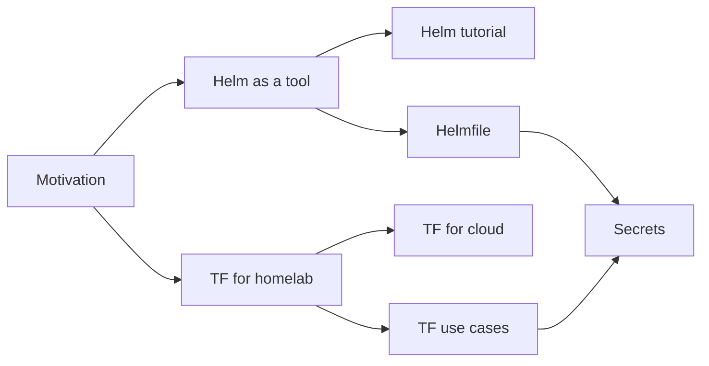

Notes that came out of the first, manual build of the homelab: a Proxmox
host running Vaultwarden, a three-node k3s cluster with Prometheus, Grafana,
Forgejo and Woodpecker CI, and a Pi-hole for local DNS. The first build was a
test run. These posts record what was learned, so the rebuild can be
declarative, repeatable and quick.

> [!TIP]
> New here? Start with [the motivation](misc/motivation.md), then follow the
> reading order below.

## Reading order



1. [Why this repo exists](misc/motivation.md)
2. [Using Helm as a tool](tools/helm.md), then [the Helm tutorial](tutorials/helm.md)
3. [Helmfile](tools/helmfile.md)
4. [TF for the homelab, in spirit](tools/tofu-for-homelab.md)
5. [OpenTofu for cloud in general](tools/tofu-for-cloud-in-general.md)
6. [TF: good and bad use cases](tools/tofu-use-cases.md)
7. [A secret store for the homelab](tools/secrets.md)

## All posts

### Miscellaneous

| Post | Summary | Date |
|------|---------|------|
| [Why this repo exists](misc/motivation.md) | The history of the manual test run, and why "steps to build up" as snippets and secrets loses to a declarative description | 2026-10-15 |

### Tools

| Post | Summary | Date |
|------|---------|------|
| [Using Helm as a tool](tools/helm.md) | Why chart versions must be pinned, and the shape of a pinned workflow | 2026-10-15 |
| [Helmfile](tools/helmfile.md) | What helmfile adds over a deploy script: diff before apply, one file of desired state | 2026-10-15 |
| [TF for the homelab, in spirit](tools/tofu-for-homelab.md) | How helmfile compares with Terraform, and where OpenTofu fits in a homelab | 2026-10-15 |
| [OpenTofu for cloud in general](tools/tofu-for-cloud-in-general.md) | OpenTofu versus Terraform on AWS and other clouds | 2026-10-15 |
| [TF: good and bad use cases](tools/tofu-use-cases.md) | Which parts of the homelab OpenTofu should and should not describe | 2026-10-15 |
| [A secret store for the homelab](tools/secrets.md) | An SSM SecureString equivalent: SOPS + age, OpenBao, Infisical | 2026-10-15 |

### Tutorials

| Post | Summary | Date |
|------|---------|------|
| [Pinning Helm chart versions](tutorials/helm.md) | Step by step: find versions, a deploy script, upgrades and rollbacks | 2026-10-15 |

## By tag

`helm`
: [Helm as a tool](tools/helm.md) · [Helm tutorial](tutorials/helm.md) · [Helmfile](tools/helmfile.md)

`opentofu`
: [Motivation](misc/motivation.md) · [TF for homelab](tools/tofu-for-homelab.md) · [TF for cloud](tools/tofu-for-cloud-in-general.md) · [TF use cases](tools/tofu-use-cases.md)

`secrets`
: [Motivation](misc/motivation.md) · [Secrets](tools/secrets.md)

`kubernetes`
: [Helm as a tool](tools/helm.md) · [Helm tutorial](tutorials/helm.md) · [Helmfile](tools/helmfile.md) · [Secrets](tools/secrets.md)

## Building the blog

The blog is a plain folder of Markdown, rendered with
[md-preview](https://bvraghav.github.io/md-preview/):

```sh
md-preview docs/blog                                  # live preview with a file tree
md-preview build docs/blog -o public/blog \
  --base-url https://<your-site>/blog                 # static site + sitemap.xml
```

With `--base-url`, md-preview writes `sitemap.xml` for search engines, dated
from each post's last git commit.

## Adding a post

1. Put it under `misc/`, `tools/` or `tutorials/`.
2. Give it frontmatter: `title`, `subtitle`, `author`, `date`, `tags`, and an
   `abstract` for longer posts.
3. Mask anything sensitive, and explain each mask in a *Placeholders*
   section at the end of the post.
4. Add a row to the right table above, and to the tags.
