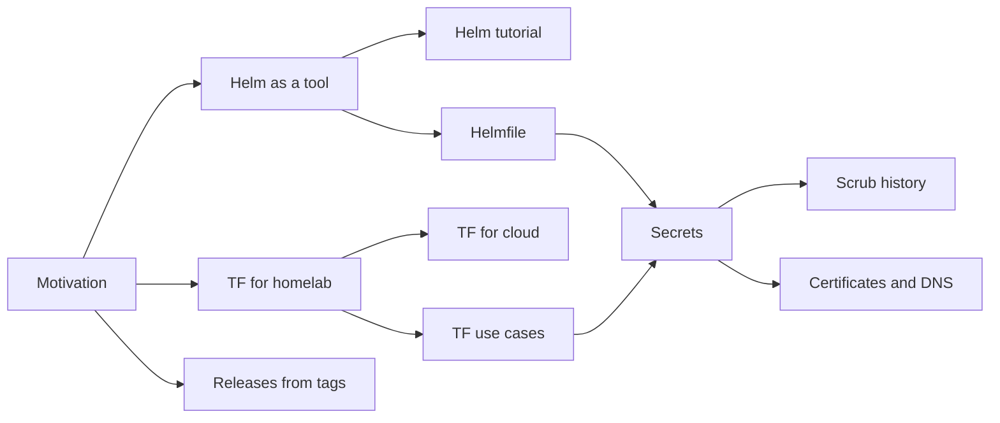

Notes that came out of the first, manual build of the homelab: a Proxmox
host running Vaultwarden, a three-node k3s cluster with Prometheus, Grafana,
Forgejo and Woodpecker CI, and a Pi-hole for local DNS. The first build was a
test run. These posts record what was learned, so the rebuild can be
declarative, repeatable and quick.

> [!TIP]
> New here? Start with [the motivation](misc/motivation.md), then follow the
> reading order below.

## Reading order



1. [Why this repo exists](misc/motivation.md)
2. [Using Helm as a tool](tools/helm.md), then [the Helm tutorial](tutorials/helm.md)
3. [Helmfile](tools/helmfile.md)
4. [TF for the homelab, in spirit](tools/tofu-for-homelab.md)
5. [OpenTofu for cloud in general](tools/tofu-for-cloud-in-general.md)
6. [TF: good and bad use cases](tools/tofu-use-cases.md)
7. [A secret store for the homelab](tools/secrets.md)
8. [How to scrub shell history to clean secrets](tutorials/scrub-history.md)
9. [Releases from tags](tools/release-workflow.md)
10. [Certificates and DNS, from a blank box](tutorials/certs-and-dns.md)

## The rebuild, step by step

One post per step of the rebuild from a blank box, in order. The steps
after 10a follow as they're done.

1. [Tools on the laptop](tutorials/laptop-tools.md)
2. [Secrets with SOPS and age](tutorials/sops-age.md)
3. [Moving DNS to Cloudflare](tutorials/dns-to-cloudflare.md)
4. [Installing Proxmox VE](tutorials/proxmox-install.md)
5. [The VMs, with OpenTofu](tutorials/opentofu-vms.md)
6. [Pi-hole](tutorials/pihole.md)
7. [Tailscale](tutorials/tailscale.md)
8. [Vaultwarden](tutorials/vaultwarden.md)
9. [k3s](tutorials/k3s.md)
10. [The platform on k3s](tutorials/k3s-platform.md) (10a)

## All posts

### Miscellaneous

| Post | Summary | Date |
|------|---------|------|
| [Why this repo exists](misc/motivation.md) | The history of the manual test run, and why "steps to build up" as snippets and secrets loses to a declarative description | 2026-10-15 |

### Tools

| Post | Summary | Date |
|------|---------|------|
| [Using Helm as a tool](tools/helm.md) | Why chart versions must be pinned, and the shape of a pinned workflow | 2026-10-15 |
| [Helmfile](tools/helmfile.md) | What helmfile adds over a deploy script: diff before apply, one file of desired state | 2026-10-15 |
| [TF for the homelab, in spirit](tools/tofu-for-homelab.md) | How helmfile compares with Terraform, and where OpenTofu fits in a homelab | 2026-10-15 |
| [OpenTofu for cloud in general](tools/tofu-for-cloud-in-general.md) | OpenTofu versus Terraform on AWS and other clouds | 2026-10-15 |
| [TF: good and bad use cases](tools/tofu-use-cases.md) | Which parts of the homelab OpenTofu should and should not describe | 2026-10-15 |
| [A secret store for the homelab](tools/secrets.md) | An SSM SecureString equivalent: SOPS + age, OpenBao, Infisical | 2026-10-15 |
| [Releases from tags](tools/release-workflow.md) | git flow, a VERSION file and one workflow; and fixing a published release's notes without touching its tag, for free | 2026-10-15 |

### Tutorials

| Post | Summary | Date |
|------|---------|------|
| [Pinning Helm chart versions](tutorials/helm.md) | Step by step: find versions, a deploy script, upgrades and rollbacks | 2026-10-15 |
| [How to scrub shell history to clean secrets](tutorials/scrub-history.md) | Find secrets in shell history without printing them, remove whole entries, rotate, and prevent it with a zsh hook | 2026-10-15 |
| [Certificates and DNS, from a blank box](tutorials/certs-and-dns.md) | Private `lab.<domain>` names in Pi-hole, a Let's Encrypt wildcard through DNS-01, and Tailscale for access from anywhere | 2026-10-15 |
| [Rebuild step 1: tools on the laptop](tutorials/laptop-tools.md) | OpenTofu, SOPS, age, Helm, helmfile, kubectl, certbot and Tailscale, installed and checked | 2026-10-15 |
| [Rebuild step 2: secrets with SOPS and age](tutorials/sops-age.md) | A laptop key, an offline backup key, `.sops.yaml`, and using secrets without typing them | 2026-10-15 |
| [Rebuild step 3: moving DNS to Cloudflare](tutorials/dns-to-cloudflare.md) | DNS hosting moved without breaking the website or email, a one-zone API token, and a staging certificate | 2026-10-15 |
| [Rebuild step 4: installing Proxmox VE](tutorials/proxmox-install.md) | Install, free repository, 2FA, SSH keys, an OpenTofu token and a Let's Encrypt certificate | 2026-10-15 |
| [Rebuild step 5: the VMs, with OpenTofu](tutorials/opentofu-vms.md) | Five Debian VMs and an R2 backup bucket from one command; encrypted state in git, addresses in SOPS | 2026-10-15 |
| [Rebuild step 6: Pi-hole](tutorials/pihole.md) | The lab's names from a VM that's all code, a pinned image, and a password pushed over SSH | 2026-10-15 |
| [Rebuild step 7: Tailscale](tutorials/tailscale.md) | The lab from anywhere with no open ports: a tagged subnet router on the Pi-hole VM, and split DNS | 2026-10-15 |
| [Rebuild step 8: Vaultwarden](tutorials/vaultwarden.md) | The vault behind Caddy and a wildcard certificate, backed up nightly to R2, restored by itself on a rebuild | 2026-10-15 |
| [Rebuild step 9: k3s](tutorials/k3s.md) | A three-node cluster from code, a token pushed from SOPS, and nightly etcd snapshots to R2 | 2026-10-15 |
| [Rebuild step 10a: the platform on k3s](tutorials/k3s-platform.md) | Lab names in pods, one wildcard certificate for every Ingress, and Grafana, from a helmfile | 2026-10-16 |

## By tag

`helm`
: [Helm as a tool](tools/helm.md) · [Helm tutorial](tutorials/helm.md) · [Helmfile](tools/helmfile.md)

`opentofu`
: [Motivation](misc/motivation.md) · [TF for homelab](tools/tofu-for-homelab.md) · [TF for cloud](tools/tofu-for-cloud-in-general.md) · [TF use cases](tools/tofu-use-cases.md) · [Step 5: VMs with OpenTofu](tutorials/opentofu-vms.md)

`secrets`
: [Motivation](misc/motivation.md) · [Secrets](tools/secrets.md) · [Scrub shell history](tutorials/scrub-history.md) · [SOPS and age](tutorials/sops-age.md)

`networking`
: [Certificates and DNS](tutorials/certs-and-dns.md) · [DNS to Cloudflare](tutorials/dns-to-cloudflare.md) · [Step 6: Pi-hole](tutorials/pihole.md) · [Step 7: Tailscale](tutorials/tailscale.md)

`rebuild`
: [Step 1: tools](tutorials/laptop-tools.md) · [Step 2: SOPS and age](tutorials/sops-age.md) · [Step 3: DNS to Cloudflare](tutorials/dns-to-cloudflare.md) · [Step 4: Proxmox VE](tutorials/proxmox-install.md) · [Step 5: VMs with OpenTofu](tutorials/opentofu-vms.md) · [Step 6: Pi-hole](tutorials/pihole.md) · [Step 7: Tailscale](tutorials/tailscale.md) · [Step 8: Vaultwarden](tutorials/vaultwarden.md) · [Step 9: k3s](tutorials/k3s.md) · [Step 10a: platform](tutorials/k3s-platform.md)

`releases`
: [Releases from tags](tools/release-workflow.md)

`kubernetes`
: [Helm as a tool](tools/helm.md) · [Helm tutorial](tutorials/helm.md) · [Helmfile](tools/helmfile.md) · [Secrets](tools/secrets.md)

## Building the blog

The blog is a plain folder of Markdown inside `docs/`, rendered with
[md-preview](https://bvraghav.github.io/md-preview/). From the repository
root:

```sh
md-preview docs/blog          # live preview of the blog, with a file tree
make serve                    # build all of docs/ and serve it at localhost:8000
```

GitHub Actions builds the site on every push to `develop` or `master`, and
publishes it to GitHub Pages for every version tag, with a `sitemap.xml`
dated from each post's last git commit. Every page's footer shows the
version it was built from: the tag for a release, or the `VERSION` file
plus `-dev` in between.

## Adding a post

1. Put it under `misc/`, `tools/` or `tutorials/`.
2. Give it frontmatter: `title`, `subtitle`, `author`, `date`, `tags`, and an
   `abstract` for longer posts.
3. Mask anything sensitive, and explain each mask in a *Placeholders*
   section at the end of the post.
4. Add a row to the right table above, and to the tags.
