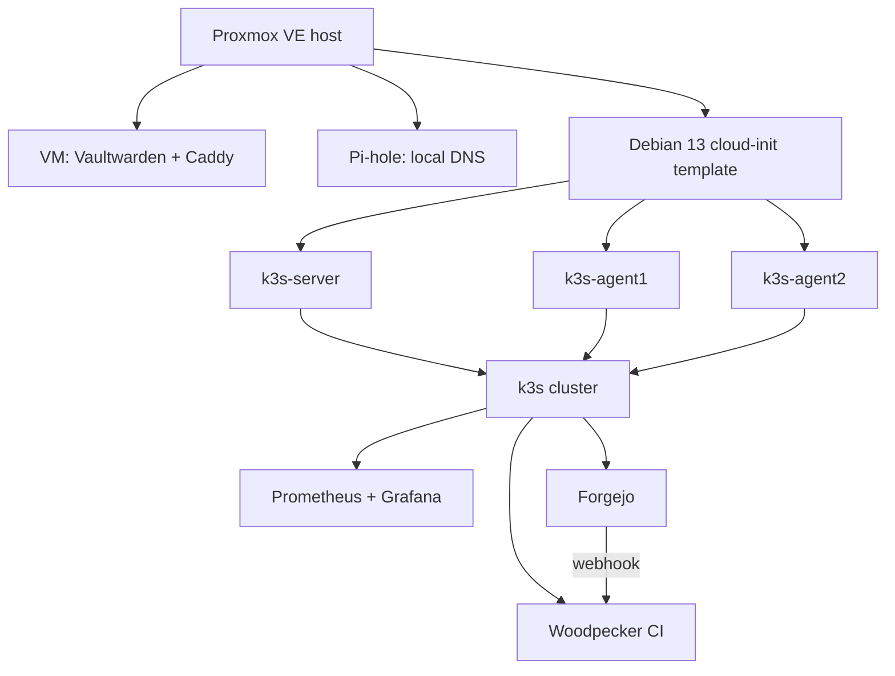

## How it started

It began with one question: *how do I install Vaultwarden on Proxmox?* There
are community scripts that do it almost instantly, but a password manager is
the last thing to run from a script I haven't read. So I asked how much
trouble it would be to do it myself.

Not much, as it turned out: about an hour of shell work. The scripts mostly
automate the easy part, creating a container and installing software. The two
hard parts, **HTTPS** and **backups**, are the same either way.

That first evening grew into a whole lab:



## What actually happened

Every service came up in the end. Getting there involved a series of small
mistakes, and each one is worth recording, because none of them was about
understanding the technology. They were all about **running steps by hand**.

### Vaultwarden

- **Docker in LXC.** The first plan used an LXC container. Proxmox recommends
  running Docker in a VM instead, so it became a small Debian VM.
- **The admin token.** Vaultwarden would not start:

  ```
  The configured Argon2 PHC in `ADMIN_TOKEN` is invalid: 'salt too short (minimum 8 bytes)'
  ```

  Docker Compose treats `$` as a variable reference, so the hash was silently
  cut to pieces. Every `$` had to be doubled:

  ```yaml
  ADMIN_TOKEN: '$$argon2id$$v=19$$m=65540,t=3,p=4$$<salt>$$<hash>'
  ```

- **A Caddyfile edit that did nothing.** `docker compose up -d` doesn't
  restart a container when only a mounted file changed. The local CA only
  appeared after `docker compose restart caddy`.
- **A phone that wouldn't trust the CA.** Tapping the certificate file on
  Android installs it as a *client* certificate, which fails. It has to be
  installed from Settings as a *CA certificate*. This one is still open.

### k3s

- **A join command with the wrong subnet.** The example used
  `192.168.1.61`; the network was a different `/24`. The agents started,
  printed `Starting k3s-agent`, and then retried forever.
- **Two agents with the same hostname.** Cloning a VM sets its hostname from
  the VM name. A "repeat for the second agent" step reused the first name,
  and Kubernetes rejected the duplicate. Then `systemctl restart k3s-agent`
  hung, because the service only reports "started" once it has joined.
- **A stale DNS server.** Cloud-init had given the nodes an old nameserver,
  so pods could not resolve `forgejo.<local-domain>`, while the laptop could.
  The fix touched four VMs (three nodes plus the template) and needed rolling
  reboots.
- **Port 80 already taken.** k3s ships Traefik on ports 80 and 443, so a test
  `LoadBalancer` on port 80 stayed pending, and `curl` got Traefik's 404.

### Helm

- **`helm install` on a release that already existed** after a first attempt
  with a placeholder domain. The fix was `helm upgrade`, or `uninstall` and
  install again.
- **An init container named `configure-gitea`** in the Forgejo chart, a
  leftover from the Gitea fork, which made the obvious `logs` command fail.

Then the pipeline went green, and every service was up.

## The problem with "steps to build up"

What this build produced was a long list of commands, each correct in the
moment, plus a set of secrets typed into the shell along the way. Rebuilding
from that list would mean running it again by hand, with the same chances of
making the same mistakes.

The mistakes above fall into a few patterns:

| Pattern | Example from this build |
|---------|------------------------|
| A value repeated by hand, and once wrong | the subnet in the agent join command |
| A step repeated by hand, and once not adapted | the second clone keeping the first clone's name |
| A setting decided implicitly | cloud-init taking a nameserver nobody chose |
| A command that isn't idempotent | `helm install` failing on an existing release |
| State nobody can see | the Caddyfile changed on disk, but not in the container |
| Secrets as command arguments | `--from-literal=password=...` saved in `~/.zsh_history` |

## What a declarative description changes

With OpenTofu (or Terraform), you describe what should exist, and the tool
works out the steps. A sketch of the three k3s nodes with the `bpg/proxmox`
provider:

```hcl
variable "k3s_nodes" {
  type = map(object({ vm_id = number, ip = string }))
  default = {
    "k3s-server" = { vm_id = 201, ip = "<server-ip>" }
    "k3s-agent1" = { vm_id = 202, ip = "<agent1-ip>" }
    "k3s-agent2" = { vm_id = 203, ip = "<agent2-ip>" }
  }
}

resource "proxmox_virtual_environment_vm" "k3s" {
  for_each  = var.k3s_nodes
  name      = each.key              # names are map keys, so they can't repeat
  vm_id     = each.value.vm_id
  node_name = "<proxmox-node>"

  clone { vm_id = 9000 }

  initialization {
    ip_config {
      ipv4 {
        address = "${each.value.ip}/24"
        gateway = var.gateway
      }
    }
    dns {
      servers = [var.pihole_ip]     # chosen once, for every node
      domain  = var.local_domain
    }
    user_account {
      username = var.user
      keys     = [file(var.ssh_pubkey)]
    }
  }
}
```

Going through the same mistakes again:

| Mistake | By hand | Declared |
|---------|---------|----------|
| Wrong subnet in the join command | pasted from an example | `var.server_ip` is defined once and referenced everywhere |
| Duplicate hostname | the second `qm clone` reused a name | names are keys of a map, and a map can't hold the same key twice |
| Stale nameserver | inherited from the host, fixed on four VMs with reboots | `dns.servers` is part of every node's definition, and the template's |
| `install` versus `upgrade` | the second run fails | `tofu apply` is idempotent: run it as often as you like |
| Hidden drift | the container kept the old file | `tofu plan` shows what differs before anything changes |
| Review | scroll back through the terminal | a Git diff of `.tf` files |
| Rebuild time | an evening of re-typing | `tofu apply`, then restore data from backup |

### Snippets versus code, in general

Snippets record *how* a system was built, once, by one person, on one day.
A declarative description records *what* the system is, and the tool turns
that into steps every time. That makes it:

- **Reviewable:** a change is a diff, not a memory.
- **Repeatable:** the tenth rebuild is as good as the first.
- **Parameterised:** a subnet, a domain or a node count is a variable, not a
  find-and-replace through notes.
- **Self-documenting:** the code is the inventory.

### Secrets, in particular

During the test run, secrets ended up in at least five places: shell history,
Kubernetes Secrets (only base64-encoded), a compose file, files on VMs, and a
kubeconfig on a laptop. A declarative setup forces the question *where does
each secret live?* and gives better answers: encrypted files in Git (SOPS +
age), OpenTofu variables marked `sensitive`, an encrypted state file, and,
later, a proper secret store. See [A secret store for the
homelab](../tools/secrets.md).

## What OpenTofu won't fix

To be fair to the snippets:

- **It doesn't configure the inside of the OS.** Installing Docker or k3s
  belongs to cloud-init or Ansible. OpenTofu can hand a cloud-init config to
  each VM, but it doesn't manage packages. See [TF: good and bad use
  cases](../tools/tofu-use-cases.md).
- **Escaping is still escaping.** If a template writes the compose file,
  `$$` still has to be right. The difference is that it gets fixed once, in
  code, and stays fixed.
- **State is a new thing to protect.** The state file can contain secrets,
  so it needs encryption, which OpenTofu supports.
- **Data is not infrastructure.** Passwords in the vault, Git repositories
  and metrics come back from backups, not from `tofu apply`.

## Where this goes

The plan in `todo.md`, at the root of the repository, is the rebuild. Decide the domain,
certificates and IP plan first, then describe the Proxmox VMs with OpenTofu,
set up their insides with cloud-init, and deploy the cluster's apps with
pinned Helm charts. The measure of success is simple: time how long a full
rebuild takes, and make that number small.

## Placeholders

Sensitive values in this post are masked. Each mask stands for:

`<local-domain>`
: The DNS suffix for the LAN, e.g. `home.arpa`. Any name works as long as
  your local DNS (Pi-hole here) answers for it. Avoid `.local`, which
  clashes with mDNS. Prefer `home.arpa` or a subdomain of a domain you own.

`<server-ip>`, `<agent1-ip>`, `<agent2-ip>`
: IPv4 addresses of the k3s nodes, e.g. `192.168.1.61`, written **without**
  a prefix length (the code appends `/24`). In `ip_config` these must be IP
  addresses; names aren't accepted. Pick them outside the router's DHCP
  range.

`<proxmox-node>`
: The Proxmox node name as shown in the web UI's tree, e.g. `pve`. This is
  a **name**, not an IP or hostname, and it is case-sensitive.

`var.pihole_ip`
: The Pi-hole's IPv4 address, e.g. `192.168.1.53`. It must be an **IP
  address**, not a name: the nodes need it in order to resolve names in
  the first place.

`var.gateway`
: The router's IPv4 address, e.g. `192.168.1.1`. IP only.

`var.user`
: The login user cloud-init creates on each VM, e.g. `admin`. Plain
  lowercase letters, digits, `-` and `_`. Avoid `root`.

`var.ssh_pubkey`
: A path to an SSH **public** key file, e.g. `~/.ssh/id_ed25519.pub`. It
  must be the public key (`.pub`), never the private one.

`<salt>`, `<hash>`
: Parts of the Argon2 hash that `vaultwarden hash` prints. They are
  base64-like strings of letters, digits, `+` and `/`. Paste them as they
  are; only the `$` separators get doubled in a compose file.
