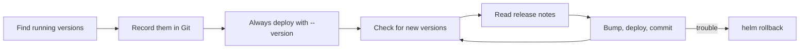

Helm installs applications into Kubernetes from **charts**: packages of
templates plus a values file you write. In the homelab, three charts run
everything: `kube-prometheus-stack` (Prometheus and Grafana), Forgejo and
Woodpecker.

## The problem: Helm doesn't pin anything for you

A release stays at whatever chart version it was installed with, until the
next `helm upgrade`. Without `--version`, that upgrade pulls the **latest**
chart. A routine settings change can then quietly bring in a new major
version, with renamed values, new defaults or a migration you didn't plan.

Chart versions and app versions are separate things. `helm list -A` shows
both. The **chart** version, e.g. `forgejo-17.3.0`, is the one to pin. The
app version inside follows from it.

## Why pinning helps

- **Repeatable:** a rebuild installs exactly what ran before.
- **Upgrades on purpose:** a version only changes when you change it, after
  reading the release notes.
- **Reviewable:** a version bump is a one-line diff in Git.
- **Recoverable:** combined with `helm history` and `helm rollback`, a bad
  upgrade can be undone.

## The work path

1. **Record** the chart version of every release in the repository.
2. **Deploy** only through something that passes those versions, such as a
   script or helmfile, using `helm upgrade --install` so that first installs
   and later changes are the same command.
3. **Upgrade deliberately:** check for new versions, read the notes, bump,
   deploy, commit.
4. **Roll back** if something breaks.

Two habits from the test run belong here too: use `helm upgrade`, not
`helm install`, once a release exists, and keep values files in Git.

The step-by-step version is in [the Helm tutorial](../tutorials/helm.md). A
more declarative way to do the same is [helmfile](helmfile.md).
