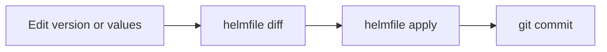

[Pinning chart versions](../tutorials/helm.md) with a deploy script works.
Helmfile does the same job declaratively. Instead of a script of `helm`
commands, you write one file listing the releases you want, and helmfile
compares that file with the cluster and makes the cluster match.

## The homelab's releases as a helmfile

```yaml
repositories:
  - name: prometheus-community
    url: https://prometheus-community.github.io/helm-charts

releases:
  - name: kps
    namespace: monitoring
    chart: prometheus-community/kube-prometheus-stack
    version: <kps-version>
    values: [monitoring.yaml]

  - name: forgejo
    namespace: forgejo
    chart: oci://code.forgejo.org/forgejo-helm/forgejo
    version: <forgejo-version>
    values: [forgejo.yaml]

  - name: woodpecker
    namespace: woodpecker
    chart: oci://ghcr.io/woodpecker-ci/helm/woodpecker
    version: <woodpecker-version>
    values: [woodpecker.yaml]
    needs: [forgejo/forgejo]    # deploy after Forgejo
```

## What it adds over a deploy script

**Preview before applying**
: `helmfile diff` shows exactly which Kubernetes resources would change,
  line by line. This is the main reason to use it. With a script, you find
  out what changed after it has happened.

**Only changed releases are touched**
: `helmfile apply` upgrades just the releases whose version or values
  changed. A script upgrades everything, every time.

**Everything in one place**
: Repos, chart versions, namespaces, values files and ordering (`needs:`).
  One file tells you what the cluster should contain.

**One app at a time**
: `helmfile -l name=forgejo apply` touches only Forgejo.

**Room to grow**
: Encrypted secrets in Git (via SOPS), several environments, templating.

## Using it

```bash
sudo pacman -S helmfile
helmfile init              # installs the helm-diff plugin it needs
cd ~/homelab/k3s
helmfile diff              # no changes, if versions match what's running
helmfile apply             # diff, then apply
```

The workflow becomes:



## Is it worth it?

For three charts, a script works fine, and helmfile is a nice-to-have. The
diff preview alone makes it worthwhile once you start upgrading charts,
because that's when surprises happen.

The step after helmfile is **GitOps** with Flux or Argo CD. The cluster then
watches a Git repository and applies changes itself, so nothing runs from a
laptop. With Forgejo already in the cluster, that's a natural later step.

For how this compares with Terraform and OpenTofu, see [TF for the homelab,
in spirit](tofu-for-homelab.md).

## Placeholders

`<kps-version>`, `<forgejo-version>`, `<woodpecker-version>`
: Chart versions as shown in the CHART column of `helm list -A`, without the
  chart name, e.g. `17.3.0`. Use exact versions so the file pins them.
