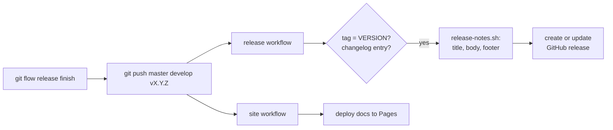

## The manual way

The first releases of this repository went like this:

1. Finish the work with git flow, and push `master` and `develop`.
2. On GitHub, draft a release and type a new tag, `vX.Y.Z`, so GitHub creates
   it on `master`.
3. Type a title: the version plus the release's name, e.g.
   `v0.0.2: Clean Slate`.
4. Paste the release's section from `RELEASE_NOTES.md` as the description.
5. Add a footer by hand: `**Full Changelog**: …/compare/v0.0.1...v0.0.2`.

Every step after the first is mechanical, and every one of them can be done
wrong: a typo in the tag, the wrong section pasted, a stale compare link.

## The automated way



A release cycle is now four commands:

```sh
git flow release start X.Y.Z
# bump VERSION; add X.Y.Z sections to CHANGELOG.md and RELEASE_NOTES.md
git flow release finish -m "X.Y.Z: Title" X.Y.Z
git push upstream master develop vX.Y.Z
```

Pushing the tag starts two workflows. `site` deploys the docs, and `release`
creates the GitHub release:

**Checks**
: The tag, without its `v`, must match the `VERSION` file, and
  `CHANGELOG.md` must have an entry for it. Otherwise the run fails and no
  release is created.

**Title**
: `v` plus the version's heading in `RELEASE_NOTES.md`, without the date.
  `## 0.0.3: Autopilot (2026-10-15)` becomes `v0.0.3: Autopilot`.

**Description**
: That section's text, from the line after its heading to the line before
  the next one.

**Footer**
: `**Full Changelog**: …/compare/<previous>...vX.Y.Z`, where *previous* is
  the nearest earlier version tag in history. That's sturdier than
  computing `X.Y.(Z-1)`, which doesn't exist after `0.1.0` or `1.0.0`.

**Create or update**
: If the release doesn't exist, it's created; if it does, its title and
  notes are replaced. Running it twice is harmless.

The extracting lives in [`scripts/release-notes.sh`](../../../scripts/release-notes.md),
not in the workflow, so a release can be previewed before tagging:

```sh
scripts/release-notes.sh X.Y.Z                      # the title
scripts/release-notes.sh --body --repo https://github.com/bvraghav/homelab X.Y.Z
```

## For free: fixing a published release's notes

After 0.0.3 went out, one sentence in its notes read badly on GitHub. It said
the notes "come from this file", which made sense in `RELEASE_NOTES.md` but
not on a release page. Fixing the file was easy. Getting the fix onto the
release was the interesting part.

A tag push builds the release from `RELEASE_NOTES.md` **as it is at the
tag**. That's right for a new release, but it means the tag's copy of the
notes is frozen. The obvious ways to change it are both bad:

- **Move the tag** to a commit with the corrected notes. A published tag
  should never move; anyone who fetched it now disagrees with the
  repository.
- **Edit the release by hand** on GitHub. Then the release and
  `RELEASE_NOTES.md` say different things, and the next automated run
  overwrites the edit anyway.

The workflow already had a manual trigger, for re-creating a release for an
existing tag. One small change made it the answer: **a manual run reads
`RELEASE_NOTES.md` from the branch it's started on**, while the version
check and the compare link still use the tag. Since the workflow already
updates a release that exists, that is all it took. So:

1. Fix the notes in `RELEASE_NOTES.md`, and merge the fix as usual.
2. **Actions → release → Run workflow**, from `master`, with the tag, e.g.
   `v0.0.3`.

The release now matches the file, and the tag hasn't moved. Nothing about
this was designed up front: it falls out of three decisions that were made
for other reasons. The notes live in a file, the workflow creates *or
updates*, and the tag is an input rather than the only source.

> [!IMPORTANT]
> **Re-run** is not **Run workflow**. Re-running an old run replays its
> original event exactly: the same tag, the same commit, even the workflow
> file as it was then. It reads the old notes again. Only a new run, started
> with **Run workflow**, picks up the corrected file. This is the mistake we
> actually made, on the third attempt of the 0.0.3 run.

## What tripped us up

**The tag prefix**
: git flow was set up with no tag prefix, but the first release on GitHub
  was tagged `v0.0.1`. The changelog's links pointed at `0.0.1`, which
  didn't exist. Setting `git config gitflow.prefix.versiontag v` makes
  `git flow release finish X.Y.Z` create `vX.Y.Z`. Pass git flow the bare
  version; it adds the `v` itself.

**The deploy rule**
: GitHub's `github-pages` environment only lets the default branch deploy,
  so the first tag deploy was rejected. Its tag rules are globs, not regular
  expressions. `v?[0-9]+(\.[0-9]+)?` is refused, while `v*.*.*` works.

**Releasing through a pull request**
: Merging `develop` into `master` with a pull request skips git flow's merge
  back into `develop`, so that has to be done by hand. `git flow release
  finish` does both merges and the tag.

**A tag created by GitHub**
: Creating the tag in GitHub's release form makes a lightweight tag on the
  target branch. It works, but with the workflow, letting git flow create an
  annotated tag locally keeps the whole cycle in the terminal.

## See also

- [`scripts/release-notes.sh`](../../../scripts/release-notes.md): the script, its
  options and limitations.
- [Using Helm as a tool](helm.md): the same idea of pinning versions,
  applied to charts.
