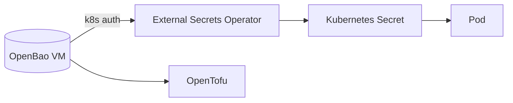

Building the homelab by hand meant handling a lot of secrets: an admin token,
an admin password, OAuth credentials, a cluster join token, a kubeconfig, a
CA key. On AWS, these would go into SSM Parameter Store as `SecureString`.
Can a homelab have the same? Yes. But first, an inventory.

## Where the secrets ended up

**Shell history**
: Commands like the following were saved by zsh, with the value in plain
  text:

  ```bash
  kubectl -n forgejo create secret generic forgejo-admin \
    --from-literal=username=<user> \
    --from-literal=password='<password>'
  ```

  Find and remove them with `grep -n 'from-literal' ~/.zsh_history`. In
  future, add `setopt HIST_IGNORE_SPACE` to `.zshrc` and start such commands
  with a space, or read values from files.

**Kubernetes Secrets**
: The Forgejo admin and Woodpecker OAuth secrets are only base64-encoded,
  not encrypted. k3s keeps them in its datastore on the server VM, and
  anyone with the kubeconfig can read them.

**Files**
: `~/.kube/config` (full cluster admin), the k3s node token on the server,
  the `ADMIN_TOKEN` hash in Vaultwarden's compose file, and Caddy's
  `root.key`.

## What SecureString actually is

Three things:

1. values **encrypted** with a managed key (KMS)
2. access **controlled** per identity (IAM)
3. an **API** that apps and tools read from

These homelab tools cover the same ground:

| | SOPS + age | OpenBao | Infisical |
|-|-----------|---------|-----------|
| Encryption | age key | built-in, sealed storage | built-in |
| Access control | whoever has the key | policies, Kubernetes service-account auth | users, projects, machine identities |
| API | none: encrypted files | yes (`bao kv get …`) | yes, plus a web UI |
| Server to run | none | yes, needs unsealing | yes, plus PostgreSQL and Redis |
| Kubernetes | Flux, helm-secrets | External Secrets Operator | its own operator |

## SOPS + age: encrypted files in Git

SOPS encrypts the **values** inside YAML or JSON files and leaves the keys
readable, so the file stays reviewable and can be committed:

```yaml
forgejo:
  admin:
    username: ENC[AES256_GCM,data:…,type:str]
    password: ENC[AES256_GCM,data:…,type:str]
sops:
  age:
    - recipient: <age-public-key>
```

- It works with what the homelab already uses: **helmfile** (through
  helm-secrets), **OpenTofu** (the `sops` provider) and **Flux** for
  GitOps.
- No server. The one thing to protect is the **age private key**. Keep a
  copy in Vaultwarden.
- It's the equivalent of committing KMS-encrypted values.

## OpenBao: the closest equivalent

OpenBao is the open-source fork of HashiCorp Vault, under the Linux
Foundation.

- A key/value store with encryption, access policies, audit logs, and an
  API and CLI.
- Pods can authenticate with their **Kubernetes service account**, which
  plays the role of an IAM role.
- **External Secrets Operator** in k3s keeps Kubernetes Secrets in sync
  with it: "this Secret comes from `secret/forgejo/admin`".
- OpenTofu can read secrets from it (the Vault provider works with OpenBao),
  so nothing secret sits in `.tf` files.
- **The cost:** it's a real service. It starts **sealed** after every
  restart and must be unsealed before it serves anything, and it needs its
  own backups. Run it on its **own small VM**, not inside the cluster that
  depends on it.



## Infisical

A self-hosted secrets manager with a friendlier web UI and a Kubernetes
operator. It needs PostgreSQL and Redis, and it's more of a product than a
building block.

> [!NOTE]
> **Vaultwarden** is for secrets *people* use. Bitwarden's machine-secrets
> product (Secrets Manager) isn't supported by Vaultwarden, so it's not a
> good backend for automation.

## Recommendation

- [ ] **Now:** clean shell history, then use **SOPS + age** for the secrets
      in this repo: Helm values, the Forgejo admin and Woodpecker OAuth
      credentials. It's small, needs nothing new running, and works with
      helmfile and OpenTofu.
- [ ] **With OpenTofu:** turn on **state encryption**, because state files
      contain secrets.
- [ ] **Later, for an SSM-like API:** OpenBao on its own VM, with External
      Secrets Operator in k3s.
- [ ] **Always:** keep the root secrets (age key, OpenBao unseal keys,
      Proxmox root password, recovery codes) in Vaultwarden, **plus an
      offline copy**, because everything else depends on them.

See also: [Why this repo exists](../misc/motivation.md).

## Placeholders

`<user>`
: A Forgejo username, e.g. `jdoe`. Lowercase letters, digits, `-`, `_` and
  `.`. `admin` is reserved by Forgejo.

`<password>`
: The admin password. Never write the real one in a document, a values file
  or a command line.

`<age-public-key>`
: An age **public** key (recipient), e.g.
  `age1ql3z7hjy54pw3hyww5ayyfg7zqgvc7w3j2elw8zmrj2kg5sfn9aqmcac8p`: the
  prefix `age1` followed by 58 lowercase letters and digits. It's safe to
  commit. The matching private key starts with `AGE-SECRET-KEY-1` and must
  never be committed.
