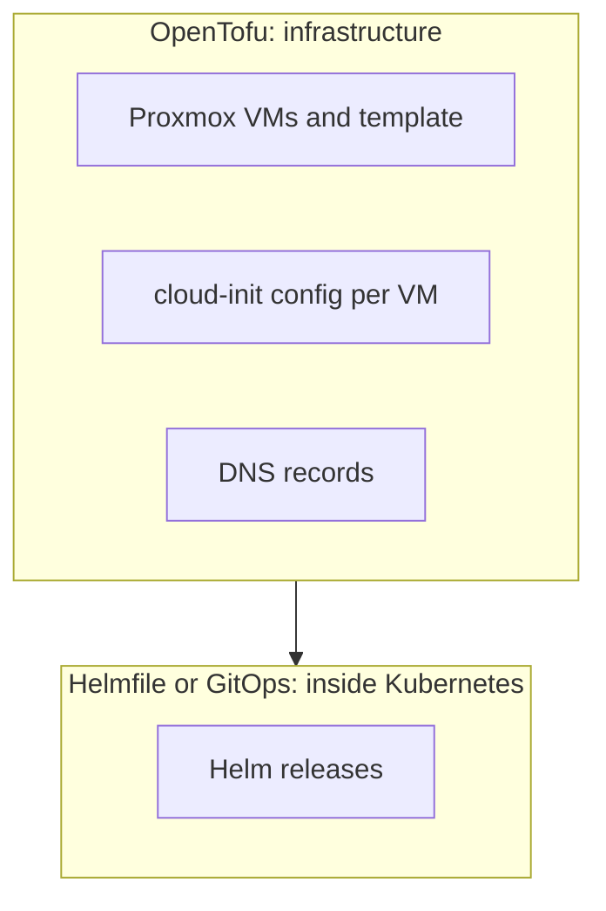

After moving the cluster's Helm releases into [helmfile](helmfile.md), the
natural question is whether this resembles Terraform, the tool used to
manage cloud resources. It does, in spirit.

## The same idea: desired state, preview, apply

| Terraform | Helmfile |
|-----------|----------|
| `.tf` files describe resources | `helmfile.yaml` describes Helm releases |
| `terraform plan` | `helmfile diff` |
| `terraform apply` | `helmfile apply` |
| Providers (AWS, Proxmox, …) | Helm charts |
| Pinned provider versions | Pinned chart versions |

## Where they differ

They differ in how they track state, and that affects how much you can
trust them.

**State**
: Terraform keeps its own state file and refreshes it against the real
  resources, so it notices changes made by hand. Helmfile has no state of
  its own; it relies on Helm's release records in the cluster. By default
  `helmfile diff` compares against what Helm last deployed, not the live
  objects, so a manual `kubectl edit` can go unnoticed. (helm-diff has a
  three-way-merge option that partly covers this.)

**Deletion**
: Remove a resource from Terraform and `apply` destroys it. Remove a release
  from `helmfile.yaml` and helmfile simply ignores it from then on. To remove
  it, set `installed: false` and apply, or uninstall it yourself.

**Scope**
: Terraform manages almost anything that has a provider. Helmfile only
  manages Helm releases.

## Terraform can do the job directly

Terraform, and its open-source fork **OpenTofu**, have a **Helm provider**
and a **Kubernetes provider**, so they can manage the same releases. More
interesting for a homelab is the widely used **Proxmox provider**
(`bpg/proxmox`). With it, the following become code:

- the VMs (Vaultwarden, the k3s nodes, Pi-hole): CPU, RAM, disks,
  cloud-init, IPs and DNS
- the cloud-init template and its clones
- possibly the backup jobs

In the test run, the `qm clone` and `qm set` commands were typed by hand,
and that's where the duplicate hostname and the stale nameserver came from.
In code, they'd be a reviewed `tofu plan`. See [Why this repo
exists](../misc/motivation.md).

## The usual split

Terraform can manage Helm releases too. The downside is that chart upgrades
and Kubernetes changes sometimes fit awkwardly into Terraform's state model,
and Kubernetes-native tools handle them more smoothly.

**For this homelab:** helmfile for the cluster's apps now. OpenTofu for the
Proxmox VMs at the rebuild, which turns rebuilding a VM into a repeatable
step instead of a list of commands.

## And the cloud?

OpenTofu works with AWS and other clouds the same way it works with
Proxmox. Only the provider changes. Details are in [OpenTofu for cloud in
general](tofu-for-cloud-in-general.md). Which parts of the homelab OpenTofu
should and shouldn't describe is in [TF: good and bad use
cases](tofu-use-cases.md).
