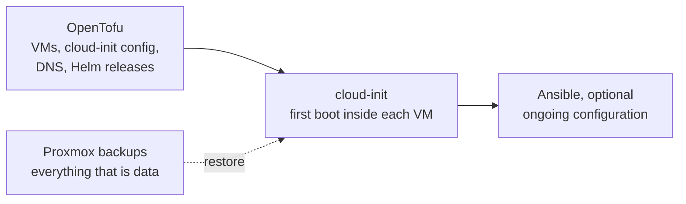

Most of it, but not all. OpenTofu is best at **creating and configuring
resources through APIs**. It isn't designed to configure what runs *inside*
an operating system. Here is everything built in the test run, sorted by
how well it fits.

## Good fit

| What was set up | How |
|-----------------|-----|
| Debian cloud image, template, VM clones (CPU, RAM, disk, start at boot) | `bpg/proxmox` provider |
| Cloud-init per VM: user, SSH key, static IP, nameserver, search domain | `bpg/proxmox` provider |
| Proxmox users, roles, ACLs (e.g. a separate admin account) | `bpg/proxmox` provider |
| Helm releases with pinned versions | `helm` provider |
| Kubernetes objects: namespaces, secrets, the `coredns-custom` ConfigMap | `kubernetes` provider |
| Grafana dashboards, data sources, alerts | official `grafana` provider |

## Possible, with community providers

Check that each one is maintained before relying on it.

- **Pi-hole DNS records:** a community Pi-hole provider exists. Check that
  it supports Pi-hole v6.
- **Forgejo users, repos and OAuth apps:** the Gitea provider works with
  Forgejo in most cases, and a Forgejo-specific provider exists too.
- **Proxmox backup jobs:** check whether your provider version supports
  them.

## Bad fit

| What | Better tool |
|------|-------------|
| The Vaultwarden VM's Debian install, done by hand from the ISO | Rebuild it from the cloud-init template, like the k3s nodes |
| Installing Docker, the compose file, the Caddyfile, `apt upgrade` | **cloud-init** (OpenTofu passes it the config), or **Ansible** |
| Installing k3s and joining the agents | cloud-init, or Ansible (the `k3s-ansible` project) |
| The router's DHCP settings | Depends on the router; most home routers have no API |
| 2FA, trusting a local CA on laptops and phones | Manual |
| **Data:** passwords in the vault, Git repos, metrics | **Backups**, never infrastructure code |

## The usual combination

**OpenTofu**
: Proxmox VMs, cloud-init configuration, DNS records, Helm releases.

**cloud-init**
: First-boot setup inside each VM: install k3s or Docker, write config
  files. Simple, and part of the VM's definition.

**Ansible** (optional)
: Ongoing configuration inside VMs, if cloud-init isn't enough.

**Proxmox backups**
: For everything that is data.

The aim: if a VM dies, `tofu apply` recreates it, cloud-init sets it up, and
the data comes back from backup.

## Adopting it without a rebuild

OpenTofu can **import** existing resources, with `import` blocks or
`tofu import`, so a running homelab can be brought under management one
piece at a time. A good first candidate is the k3s VMs: they're already
cloud-init clones, which is the closest to what OpenTofu expects.

See also: [Why this repo exists](../misc/motivation.md) and [TF for the
homelab, in spirit](tofu-for-homelab.md).
