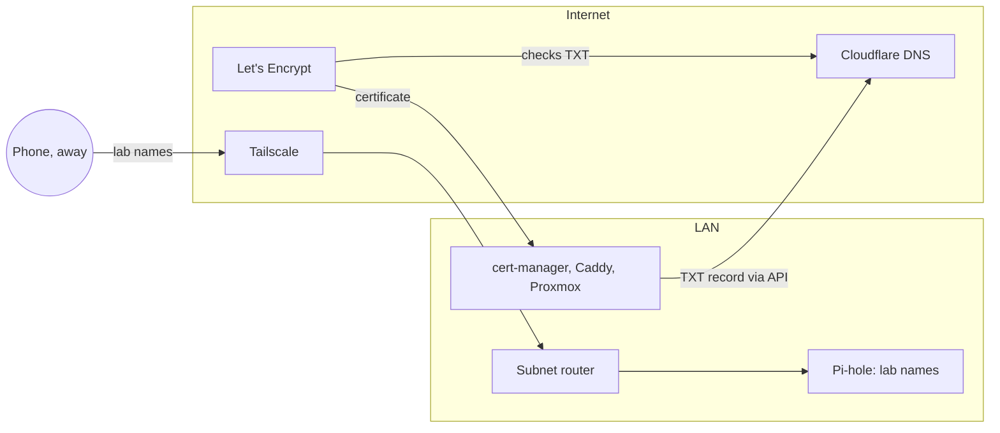

## Why this is needed

The test run named everything under `212bn`, a name that isn't reserved
for private use, and served HTTPS from Caddy's local certificate authority.
Laptops could be made to trust that CA. Phones mostly couldn't: Android
asks for a user-installed CA to be added by hand, and many apps ignore it
anyway.

A certificate every device already trusts needs a public certificate
authority, and a public CA needs a real domain. That doesn't mean the lab
has to be public: a DNS challenge proves you control the domain without
the CA ever connecting to your network.

## The design

| Part | Choice | Public? |
|------|--------|---------|
| Names | `<X>.lab.<domain>`, e.g. `grafana.lab.<domain>` | No: only Pi-hole knows them |
| Certificate | Let's Encrypt wildcard, `*.lab.<domain>` | The certificate is logged; the app names aren't |
| Proof of control | DNS-01: a temporary TXT record at the DNS provider | Only while it's being issued |
| Remote access | Tailscale: a subnet router, and split DNS to Pi-hole | No open ports |
| DNS provider | Cloudflare (any provider with an API works) | Hosts `<domain>` |



Inside the LAN, Pi-hole is the DNS server DHCP hands out, so
`grafana.lab.<domain>` resolves to a LAN address. Outside, Tailscale sends
lookups for `lab.<domain>` to the same Pi-hole and routes the LAN addresses
over the tailnet. The same name and the same certificate work in both
places.

## What you need to know first

**A wildcard covers exactly one label**
: `*.lab.<domain>` covers `grafana.lab.<domain>`, but not `lab.<domain>`
  itself, and not `a.b.lab.<domain>`. So the certificate lists both
  `lab.<domain>` and `*.lab.<domain>`. A `*.<domain>` wildcard would cover
  `grafana-lab.<domain>` instead, but it would also be valid for every
  public name under the domain, so a key leaked from the lab could
  impersonate `www.<domain>`.

**Every certificate is published**
: Let's Encrypt logs every certificate it issues in public Certificate
  Transparency logs, which anyone can search. A wildcard publishes
  `*.lab.<domain>`; a certificate for one name publishes that name. Use
  the wildcard wherever the name is nobody else's business.

**DNS-01 needs no inbound connection**
: The client asks the DNS provider's API to create a TXT record at
  `_acme-challenge.lab.<domain>`, Let's Encrypt looks it up in public DNS,
  and the client deletes it. Nothing on the LAN is reachable from outside,
  and you don't need dynamic DNS.

**The API token is a key to your domain**
: Whoever has it can change `<domain>`'s DNS records. Scope it to one zone,
  keep it in the password manager and in SOPS, and never type it as part of
  a command.

**Let's Encrypt has rate limits**
: Five certificates for the same set of names a week. Test against the
  **staging** server first; its certificates aren't trusted, but its limits
  are generous.

## The order, on a blank box

| Step | Needs | Done from |
|------|-------|-----------|
| 1. Move `<domain>`'s DNS to Cloudflare | The domain | Browser |
| 2. Create the API token | Step 1 | Browser |
| 3. Test a certificate from the laptop | Step 2 | Laptop |
| 4. Install Proxmox, with its own certificate | Step 2 | Proxmox installer, then its web UI |
| 5. Pi-hole and the lab names | Proxmox, if Pi-hole runs there | Pi-hole's web UI, router |
| 6. Tailscale: subnet router and split DNS | Step 5 | A lab machine, Tailscale admin console |
| 7. Caddy on the Vaultwarden VM | Steps 2 and 5 | The VM |
| 8. cert-manager on k3s | Steps 2 and 5 | Laptop, with the kubeconfig |
| 9. Check it all | Everything | Laptop and phone, at home and away |

If Pi-hole runs on its own device rather than on Proxmox, step 5 can come
before step 4.

## 1–3. DNS at Cloudflare, an API token, a test certificate

[Rebuild step 3: moving DNS to Cloudflare](dns-to-cloudflare.md) walks
through all three: moving `<domain>`'s DNS hosting (not the domain) to
Cloudflare without breaking the website or email, a token that can only
edit that one zone, stored with SOPS, and a staging certificate for
`lab.<domain>` and `*.lab.<domain>` from the laptop.

Add **no** public records for `lab`. The lab's names live in Pi-hole only.

## 4. Install Proxmox, with its own certificate

[Rebuild step 4: installing Proxmox VE](proxmox-install.md) installs it
with the hostname `proxmox.lab.<domain>` and the router as its DNS server,
then gives the web UI a Let's Encrypt certificate through Proxmox's own
ACME client and the Cloudflare token.

That certificate names `proxmox.lab.<domain>`, so the name appears in the
public logs. If that matters, upload the wildcard from step 8 instead,
under **Upload Custom Certificate**, and renew it by hand or by script.

## 5. Pi-hole and the lab names

Give Pi-hole a static address, `<pihole-ip>`, then follow the steps below.
In this lab they're code: [rebuild step 6](pihole.md) generates the
records from the network file.


1. In Pi-hole, **Settings → Local DNS Records**, add one A record per
   machine and one CNAME per app on k3s:

   | Type | Name | Target |
   |------|------|--------|
   | A | `proxmox.lab.<domain>` | `<proxmox-ip>` |
   | A | `vault.lab.<domain>` | `<vault-ip>` |
   | A | `ingress.lab.<domain>` | `<ingress-ip>` |
   | CNAME | `grafana.lab.<domain>` | `ingress.lab.<domain>` |
   | CNAME | `forgejo.lab.<domain>` | `ingress.lab.<domain>` |
   | CNAME | `ci.lab.<domain>` | `ingress.lab.<domain>` |

   Traefik listens on every k3s node, so `ingress` can point at the
   server. A new app on k3s is one more CNAME.

2. In the DHCP server's settings, hand out `<pihole-ip>` as the DNS server.
   Devices pick it up when they renew their lease; reconnecting does it
   now.
3. On Proxmox, change the DNS server to `<pihole-ip>` (**proxmox → System →
   DNS**), and set the search domain to `lab.<domain>`.

Use one record per name, not a dnsmasq wildcard for all of
`lab.<domain>`. A wildcard would also answer for
`_acme-challenge.lab.<domain>`, and certificate clients checking for their
TXT record through Pi-hole would never see it.

> [!TIP]
> If Pi-hole runs on Proxmox, have DHCP hand out a second, public DNS
> server too. Lab names won't resolve while Proxmox is down, but the
> internet keeps working.

## 6. Tailscale: subnet router and split DNS

In this lab, [rebuild step 7](tailscale.md) does this from code, with a
tagged auth key.

Pick a lab machine that's always on; the Pi-hole host is a good fit.

```sh
curl -fsSL https://tailscale.com/install.sh | sh
echo 'net.ipv4.ip_forward = 1' | sudo tee /etc/sysctl.d/99-tailscale.conf
sudo sysctl --system
sudo tailscale up --advertise-routes=<lan-subnet>
```

Then, in the Tailscale admin console:

1. **Machines → that machine → Edit route settings**: approve
   `<lan-subnet>`.
2. **DNS → Nameservers → Add nameserver → Custom**: `<pihole-ip>`, with
   **Restrict to domain** on, for `lab.<domain>`.

Phones accept routes by default. Linux clients need
`sudo tailscale up --accept-routes`.

## 7. Caddy on the Vaultwarden VM

In this lab, [rebuild step 8](vaultwarden.md) does this from code.

Caddy only does DNS-01 with a plugin for the DNS provider, so it needs a
custom build. A `Dockerfile` next to the compose file:

```dockerfile
FROM caddy:2-builder AS builder
RUN xcaddy build --with github.com/caddy-dns/cloudflare

FROM caddy:2
COPY --from=builder /usr/bin/caddy /usr/bin/caddy
```

The Caddyfile:

```
vault.lab.<domain> {
	tls {
		dns cloudflare {env.CF_API_TOKEN}
		resolvers 1.1.1.1
	}
	reverse_proxy vaultwarden:80
}
```

`CF_API_TOKEN` comes from a SOPS-encrypted env file, decrypted at deploy
time. `resolvers` makes Caddy check its TXT record in public DNS rather
than through Pi-hole.

This certificate names `vault.lab.<domain>`. To keep that name out of the
logs, use `*.lab.<domain>` as the site address and match the host inside
it.

## 8. cert-manager on k3s

cert-manager gets the wildcard once, and Traefik serves it as the default
certificate for every Ingress, so no app needs its own TLS setup.

Install cert-manager with these Helm values, so it checks TXT records in
public DNS and not through CoreDNS and Pi-hole:

```yaml
crds:
  enabled: true
extraArgs:
  - --dns01-recursive-nameservers-only
  - --dns01-recursive-nameservers=1.1.1.1:53,1.0.0.1:53
```

The token is a Secret named `cloudflare-token`, key `api-token`, in
cert-manager's own namespace (a ClusterIssuer reads Secrets only from
there), created from a SOPS file. Then:

```yaml
apiVersion: cert-manager.io/v1
kind: ClusterIssuer
metadata:
  name: letsencrypt
spec:
  acme:
    # Staging first; switch to
    # https://acme-v02.api.letsencrypt.org/directory once it works.
    server: https://acme-staging-v02.api.letsencrypt.org/directory
    email: <email>
    privateKeySecretRef:
      name: letsencrypt-account
    solvers:
      - dns01:
          cloudflare:
            apiTokenSecretRef:
              name: cloudflare-token
              key: api-token
---
apiVersion: cert-manager.io/v1
kind: Certificate
metadata:
  name: lab-wildcard
  namespace: kube-system
spec:
  secretName: lab-wildcard-tls
  dnsNames:
    - lab.<domain>
    - '*.lab.<domain>'
  issuerRef:
    name: letsencrypt
    kind: ClusterIssuer
---
apiVersion: traefik.io/v1alpha1
kind: TLSStore
metadata:
  name: default
  namespace: kube-system
spec:
  defaultCertificate:
    secretName: lab-wildcard-tls
```

k3s runs Traefik in `kube-system`, so the certificate lives there too. An
Ingress then only needs a host and a `tls` entry without a `secretName`:

```yaml
spec:
  tls:
    - hosts: [grafana.lab.<domain>]
  rules:
    - host: grafana.lab.<domain>
      # ...
```

Watch it with `kubectl -n kube-system get certificate lab-wildcard`; it's
done when `READY` is `True`. Then switch the issuer to the production URL,
and delete the `lab-wildcard-tls` Secret so it's issued again.

## 9. Check it all

From the laptop, at home:

```sh
dig +short grafana.lab.<domain>            # a LAN address, from Pi-hole
dig +short grafana.lab.<domain> @1.1.1.1   # nothing: the name isn't public
curl -sI https://grafana.lab.<domain> | head -1
```

`curl` succeeding without `-k` means the certificate is trusted. Then on
the phone, with WiFi off and Tailscale on, open
`https://grafana.lab.<domain>` and `https://vault.lab.<domain>`: no
warnings, same names.

## What can go wrong

**The domain stops resolving after the nameserver change**
: DNSSEC was still on at the registrar. Remove the DS record there; add
  Cloudflare's once the domain is active.

**The certificate never issues; the TXT record "isn't there"**
: The client is checking through Pi-hole or CoreDNS. Point its checks at
  public resolvers (`resolvers` in Caddy, the cert-manager flags above),
  and don't use a wildcard record for `lab.<domain>` in Pi-hole.

**cert-manager can't find the token**
: The Secret is in the wrong namespace. A ClusterIssuer reads Secrets
  from cert-manager's own namespace.

**Phones resolve lab names at home but not away, or the reverse**
: At home, Android's *Private DNS* set to a specific provider bypasses
  Pi-hole; set it to *Automatic* or *Off*. Away, check the route is
  approved and split DNS is restricted to `lab.<domain>`.

**"Too many certificates already issued"**
: The production rate limit. Wait a week, and test on staging next time.

## See also

- [A secret store for the homelab](../tools/secrets.md): SOPS + age, for
  the API token.
- [Pinning Helm chart versions](helm.md): installing cert-manager the
  same way as every other chart.
- [The task list](../../../todo.md): sections 1 and 4 to 6, where these
  steps are tracked.
- [Back to the blog](../MANIFEST.md)

## Placeholders

`<domain>`
: Your domain, e.g. `example.com`. The lab lives under `lab.<domain>`.

`<email>`
: The address Let's Encrypt sends expiry warnings to.

`<token>`
: The Cloudflare API token from step 2. Never on a command line; through
  an editor into a private file, or from SOPS.

`<zone-id>`
: The Zone ID from `<domain>`'s Overview page in Cloudflare, 32 hex
  characters. Not secret.

`<lan-subnet>`
: The LAN, in CIDR form, e.g. `192.168.1.0/24`.

`<gateway-ip>`
: The router that is the LAN's gateway, e.g. `192.168.1.1`.

`<proxmox-ip>`, `<pihole-ip>`, `<vault-ip>`
: Static addresses from the IP plan, outside the DHCP range.

`<ingress-ip>`
: The k3s server's address. Traefik listens on 80 and 443 on every node.
